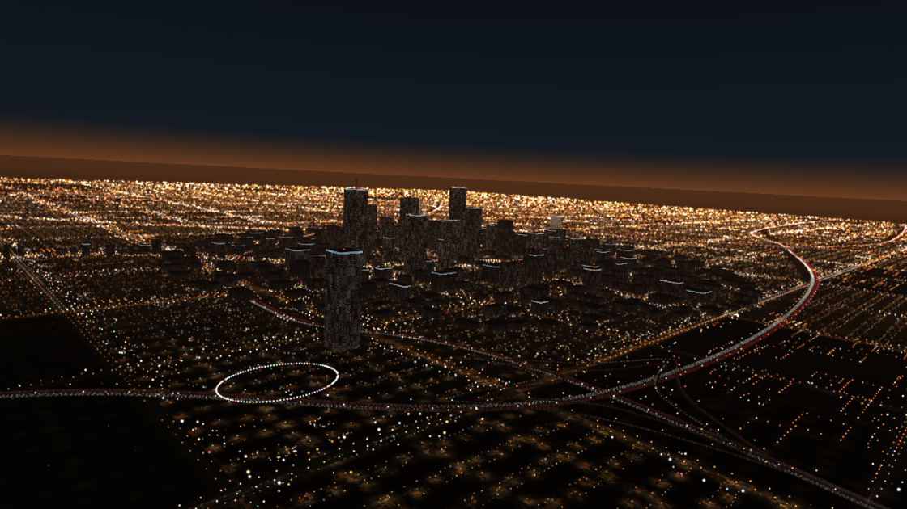
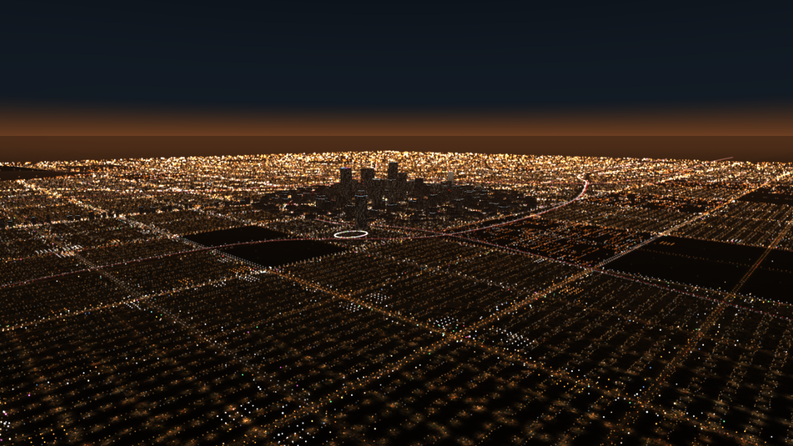
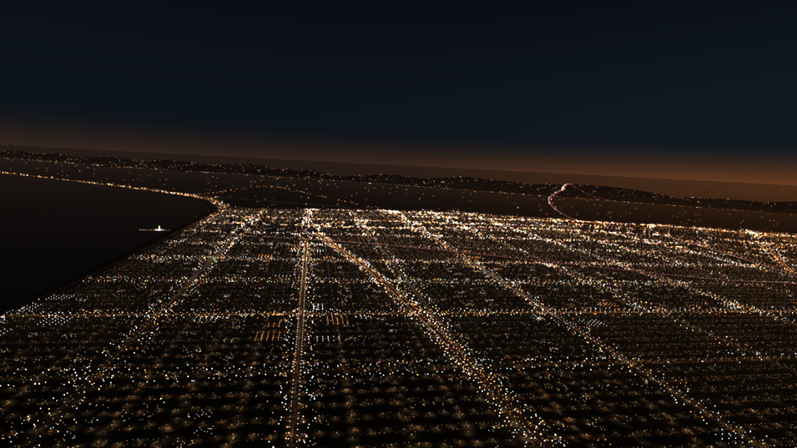
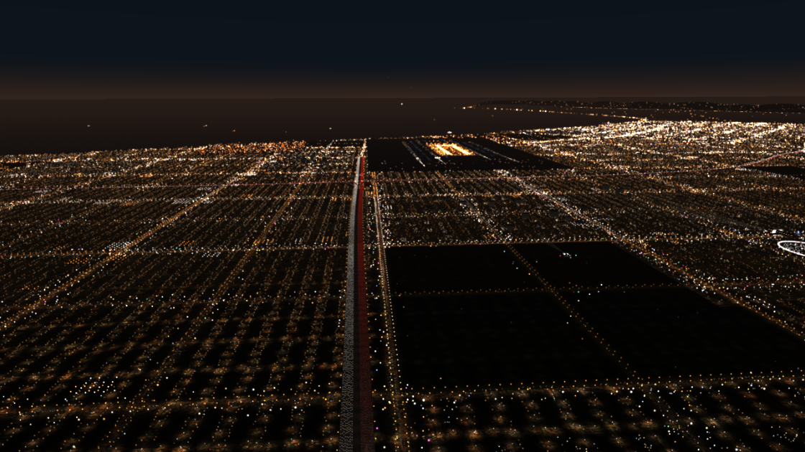

# CT58.A6.LANight

A browser WebGL / three.js flight over Los Angeles at night, MIDI-enabled (in the style of CT30 Highways). A helicopter at 3,000 ft flies west along the 105 toward
LAX over dark suburbs lit by their street lights; turn (slowly, banking) toward downtown's towers and freeways, Hollywood, Wilshire, Sunset or Santa Monica; the
hills on the horizon carry their sparse lights.

| | |
|---|---|
|  |  |
|  | |

## Run
Open `index.html` in Chrome or Edge (everything is local, three.js included). Press **?** for the keys; **A / C / K / Y** turn toward LAX / downtown / Santa
Monica / Hollywood, **G** back to the 105, **D** hides the buttons. Knobs 1–8 on an X-TOUCH MINI set the speeds of the 8 westbound lanes. **R** records an MP4 with sound.

## More
`CT58.A6.LANight.md` is the full context. Screenshots are taken from the running page (headless Chromium).
